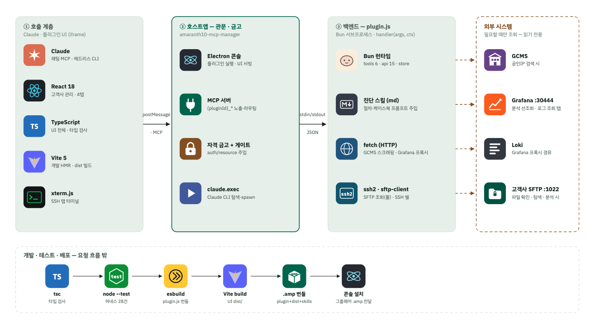

## 한 줄 요약

> 사람이 여러 시스템을 오가며 하던 e나라도움 연동 오류 분석을, **AI가 조회 전용 도구로 근거를 모으고 케이스북과 대조해 리포트까지 작성하는** 플러그인으로 자동화했습니다.

## 배경

- e나라도움 연동 오류가 발생하면 담당자가 직접 여러 단계를 수작업으로 거쳐야 했습니다.
  - GCMS에서 고객사 공인 IP를 찾기
  - Grafana/Loki에서 로그를 조회하기
  - 고객사 SFTP에 접속해 송수신 파일을 확인하기
  - 이 결과들을 서로 대조해 원인을 판단하기
- 이 과정이 한 건당 약 2시간이 걸렸고, 담당자 경험에 따라 판정 기준도 달랐습니다.

## 아키텍처

| 계층 | 구성 |
| --- | --- |
| ① 호출 계층 | Claude(채팅 MCP · 헤드리스 CLI), 플러그인 UI(React 18 · TypeScript · Vite 5, iframe), xterm.js SSH 터미널 |
| ② 호스트 앱 (관문 · 금고) | Electron 콘솔, MCP 서버(`{pluginId}_*` 노출·라우팅), 자격 금고 + 게이트(auth/resource 주입), `claude.exec`(Claude CLI 탐색·실행) |
| ③ 백엔드 (`plugin.js`) | Bun 서브프로세스, 진단 스킬(Markdown), fetch(GCMS 스크래핑 · Grafana 프록시), ssh2 · sftp-client |
| 외부 시스템 | GCMS, Grafana, Loki, 고객사 SFTP (필요할 때만, 읽기 전용으로 조회) |

- UI와 호스트 앱은 `postMessage`/MCP로 통신합니다.
- 호스트 앱과 백엔드는 stdin/stdout으로 JSON을 주고받습니다.
- 개발과 배포는 `tsc` 타입 검사 → `node --test`(하네스 28건) → `esbuild` 번들 → Vite 빌드 → `.amp` 번들 → 콘솔 설치 순서로 진행합니다.

## 담당 업무

혼자 진행한 프로젝트라 기획, 설계, 백엔드, 프론트엔드, 배포 체계까지 모두 맡았습니다.

1. **보안 중심 AI 아키텍처 설계**: 자격증명 주입 방식, 조회 전용 도구와 UI 전용 API의 분리
2. **타 시스템 연동**: GCMS · Grafana/Loki · SFTP
3. **대용량 로그 처리와 AI 분석 파이프라인 최적화**
4. **진단 지식 체계화**: 케이스북 기반 장애 판정 로직
5. **배포 체계 구축**: `esbuild` + `.amp` 번들, 사내 GitLab 마켓플레이스

## 주요 문제와 해결

### 1. AI에게 운영 시스템 접근을 맡겨도 안전하게

- **상황**: AI가 GCMS, Loki, 고객사 SFTP 같은 운영 시스템을 조회해야 했습니다. 그런데 계정 정보가 모델이나 UI에 노출되거나, AI가 쓰기 작업을 실행하는 일은 반드시 막아야 했습니다.
- **해결**
  - 자격증명은 **호스트 PC의 금고**에 두고, 호출할 때 게이트가 auth/resource를 주입하는 방식으로 설계했습니다. 그래서 모델과 UI는 민감정보를 전혀 볼 수 없습니다.
  - Claude에 공개하는 도구는 **조회 전용**으로 제한하고, UI에서만 쓰는 API(15종)와 분리했습니다.
  - Claude CLI를 실행할 때 `--allowedTools`로 허용 도구를 명시해서, 쓰기 작업은 **구조적으로 호출할 수 없게** 했습니다.
- **결과**: 운영 시스템을 AI 분석에 활용하면서도 정보 노출과 의도하지 않은 변경을 막는 구조가 되었습니다.

### 2. 대용량 로그를 AI에 그대로 넣지 않기

- **상황**: Loki 로그와 SFTP 파일은 양이 많습니다. 모델에 그대로 넘기면 토큰 사용량과 응답 시간이 크게 늘고, 컨텍스트 한도를 넘을 수 있었습니다.
- **해결**
  - 대용량 로그는 백엔드에서 **먼저 조회**하고, AI는 그 결과를 **해석만** 하도록 역할을 나눴습니다.
  - 큰 파일은 **리소스 ID로 등록**해두고, AI가 `grep`/`read`로 필요한 부분만 조회하게 했습니다.
  - SFTP는 **커넥션 풀**(30초 동안 유휴 연결을 재사용)로 반복 접속 비용을 줄였습니다. 인증은 `.ppk`/OpenSSH 키를 모두 지원하고, 접속 상태를 배지로 보여줍니다.
- **결과**: 토큰 사용량과 응답 시간을 줄이고, 모델 컨텍스트 한도 안에서 대용량 근거를 분석할 수 있게 되었습니다.

### 3. 진단 기준을 사람이 아닌 문서로 표준화하기

- **상황**: 오류 원인 판단과 책임 주체(자사 / e나라도움 / 인프라) 구분이 담당자 경험에 따라 달랐습니다. 새로운 사례가 생길 때마다 코드를 고치는 방식으로는 확장하기 어려웠습니다.
- **해결**
  - 진단 절차와 과거 사례를 **Markdown 스킬 문서(케이스북 12건)**로 정리해서 AI에 주입했습니다.
  - 연동 단계별로 **성공 증거**가 있는지를 대조하는 로직을 만들어, 장애 원인과 책임 주체를 일관되게 판정하도록 했습니다.
  - 새 케이스는 문서만 추가하면 반영되므로 **코드를 다시 배포할 필요가 없습니다**.
- **결과**: 오류 판정 과정이 표준화되었고, 누적된 케이스북이 팀의 자산이 되었습니다.

## 사용 방식과 UI

- 두 가지 방식으로 쓸 수 있습니다.
  - **대화형**: Claude 채팅에서 MCP 도구로 진단을 요청
  - **UI 버튼 연동**: 플러그인 화면에서 버튼 한 번으로 분석 실행
- 진행 상황은 1.5초마다 폴링해서 **분석 상태 체크리스트**로 보여줍니다.
- 고객사별로 **최근 분석 이력 20건**을 남깁니다.
- 분석 리포트는 `marked` + `dompurify`로 안전하게 렌더링하고, `xterm.js` 기반 SSH 터미널 탭도 제공합니다.

## 성과

- 로그와 파일을 수동으로 교차 조사하던 절차를 **원클릭으로 자동화**했습니다. 원인 조사 시간이 **약 2시간에서 30분 이내로, 70% 이상 단축**되었습니다.
- 반복되는 오류의 판정 절차를 표준화했고, **케이스북 12건**을 자산으로 쌓았습니다.
- `esbuild` + `.amp` 번들 패키징과 **사내 GitLab 마켓플레이스 배포 체계**를 마련했습니다.

## 회고

<!-- TODO: 직접 채워주세요. 예시 질문:
  - 조회 전용 도구와 UI 전용 API를 나누면서 고민했던 경계는?
  - "선조회 후 AI 해석" 구조를 택하기 전에 시도했던 방식이 있었다면?
  - 케이스북이 늘어날수록 생길 문제(프롬프트 길이, 상충 케이스)는 어떻게 다룰 계획인지?
-->
