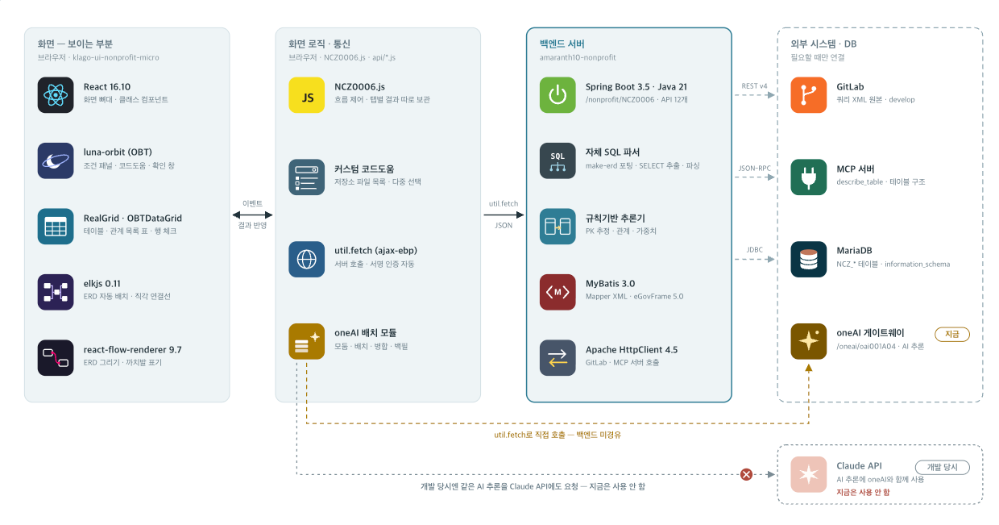

## 한 줄 요약

> 관리되지 않던 사내 ERP의 테이블 관계도를 **소스코드 쿼리 파싱 + AI 관계 추론**으로 자동 생성하고, 사람이 검토·확정할 수 있는 웹 서비스로 만들었습니다.

## 배경

- 사내 ERP는 테이블 수가 많고 오래 운영되면서 **테이블 관계 정보(ERD)가 따로 관리되지 않는** 상태였습니다.
- 그래서 신규 기능을 개발하거나 업무를 인수인계할 때마다 기존 쿼리를 하나하나 열어보면서 테이블 관계를 직접 파악해야 했습니다.
- 사람이 손으로 관리하기에는 규모가 너무 크고 변경도 잦아서, **소스코드에서 관계를 뽑아내 자동으로 최신 상태를 유지하는 방법**이 필요했습니다.

## 아키텍처

| 영역 | 구성 |
| --- | --- |
| 화면 | React 16, 사내 UI 컴포넌트(OBT), RealGrid, `react-flow-renderer` + `elkjs`로 ERD 렌더링 |
| 화면 로직 · 통신 | 탭별 결과를 따로 보관하는 흐름 제어, 저장소 파일 다중 선택 코드도움, oneAI 배치 모듈 |
| 백엔드 | Spring Boot 3.5 · Java 21, 자체 SQL 파서, 규칙 기반 추론기, MyBatis, Apache HttpClient |
| 외부 연동 | GitLab REST API(쿼리 XML 원본), MCP 서버(테이블 구조 조회), MariaDB, oneAI 게이트웨이 |

- AI 추론은 개발 당시 **Claude API와 사내 oneAI**를 모두 사용했고, 현재는 **oneAI만** 사용합니다.
- oneAI 호출은 화면에서 게이트웨이로 바로 보내도록 해서 백엔드를 거치지 않습니다.

## 담당 업무

혼자 진행한 프로젝트라 기획, 설계, 백엔드, 프론트엔드, 외부 시스템 연동까지 모두 맡았습니다.

1. **소스코드 기반 스키마 자동 추출**: GitLab API로 쿼리 XML을 수집하고, SQL을 파싱해 테이블·컬럼·JOIN 조건을 추출
2. **사내 DB 연동 MCP 개발**: AI Agent가 DB 메타데이터를 조회할 수 있는 전용 인터페이스
3. **하이브리드 관계 추론 설계**: 규칙 기반 추론과 AI Agent 추론을 함께 사용하는 구조
4. **관계 큐레이션 · 이력 관리**: 후보/확정/제외 상태 관리와 근거 가중치 누적
5. **ERD 시각화 웹 애플리케이션**: 자동 레이아웃, 필터, 관계 수정, 다중 입력 분석

## 주요 문제와 해결

### 1. 대량의 쿼리 XML을 안정적으로 수집하기

- **상황**: 관계를 추출하려면 ERP 저장소에 흩어져 있는 MyBatis 쿼리 XML을 모두 읽어와야 했습니다. 파일 수가 많아서 한 번에 가져오면 외부 API에 부담이 컸습니다.
- **해결**
  - GitLab REST API의 저장소 트리를 **페이지 단위로 나눠서** 순회하며 쿼리 XML을 수집했습니다.
  - 한 번 가져온 결과는 **캐시**해서 같은 파일을 반복해서 요청하지 않도록 했습니다.
  - 수집한 SQL은 자체 SQL 파서로 SELECT 구문을 추출하고, 사용된 테이블·컬럼·JOIN 조건을 구조화했습니다.
- **결과**: 외부 API 부하를 최소화하면서 저장소 전체를 분석 대상으로 삼을 수 있게 되었습니다.

### 2. AI가 DB를 보되, DB를 직접 노출하지 않기

- **상황**: 정확하게 추론하려면 AI Agent가 실제 테이블 구조(컬럼, 키 등)를 알아야 했습니다. 하지만 AI에 DB 접근 권한을 직접 주는 것은 보안상 받아들일 수 없었습니다.
- **해결**
  - 사내 DB 메타데이터를 조회하는 **전용 MCP 서버**를 개발했습니다. 테이블 구조 조회(`describe_table`) 같은 정해진 도구만 제공합니다.
  - 백엔드가 MCP 서버를 JSON-RPC로 호출하는 **중계 구조**로 설계해서, AI는 허용된 메타데이터만 볼 수 있게 했습니다.
- **결과**: DB를 직접 노출하지 않으면서도 AI Agent가 필요한 정보를 실시간으로 조회할 수 있게 되었습니다.

### 3. AI 응답이 실패해도 결과는 나오게 하기

- **상황**: AI 추론은 복잡한 비즈니스 관계를 잘 찾아내지만 응답 오류나 지연이 생길 수 있습니다. 테이블이 많으면 한 번에 처리하기도 어렵습니다.
- **해결**: 두 가지 추론 방식을 함께 쓰는 **하이브리드 구조**로 설계했습니다.
  - **규칙 기반 추론**: SQL의 JOIN 조건을 매칭하고 PK를 추정해서, AI를 호출하지 않아도 기본 관계가 나오도록 했습니다.
  - **AI Agent 추론**: 테이블을 클러스터링해서 배치로 나눈 뒤 추론하도록 했습니다. 배치 결과는 병합하고, 실패한 배치는 다시 채워 넣습니다.
  - AI 쪽에서 오류나 지연이 생겨도 규칙 기반 결과로 서비스가 계속 유지됩니다.
- **결과**: AI 상태와 관계없이 안정적으로 결과를 제공하면서, 규칙만으로는 찾기 어려운 관계까지 도출할 수 있었습니다.

### 4. 자동 추론 결과를 믿을 수 있게 만들기

- **상황**: 자동으로 추론한 관계에는 틀린 것도 섞여 있습니다. 분석을 다시 돌릴 때마다 사람이 검토한 결과가 덮어써지면 안 됐습니다.
- **해결**
  - 관계에 **후보 / 확정 / 제외** 상태를 두고, `RELATION_KEY` 기준으로 upsert해서 재분석해도 검토 결과가 유지되도록 했습니다.
  - 각 관계가 몇 개의 파일에서 근거를 찾았는지를 **가중치로 누적**해서, 사용자가 신뢰도를 판단할 수 있게 했습니다.
- **결과**: 자동 생성과 사람의 검토가 함께 쌓이면서 ERD 품질이 점점 높아지는 구조가 되었습니다.

## ERD 시각화

- `elkjs`로 자동 레이아웃을 계산하고 `react-flow`로 ERD를 그렸습니다. 관계선은 직각으로 연결하고, 컬럼 단위까지 표시합니다.
- 모듈별·상태별 필터, 관계 수정 팝업을 구현했습니다.
- SQL을 직접 붙여넣거나 저장소 파일을 여러 개 골라서 분석할 수 있도록 다중 입력을 지원합니다. 입력마다 상태를 별도 버퍼로 분리해 관리했습니다.

<!-- TODO: 실제 화면 캡처를 erd-screen.png로 추가하면 아래 줄의 주석을 해제하세요 -->
<!--  -->

## 성과

- 손으로는 관리할 수 없던 **대규모 ERP 테이블 관계도를 자동으로 최신화**할 수 있게 되었습니다.
- 신규 모듈 분석과 쿼리 작성 시간이 **프로세스 1건 기준 약 2일에서 2시간 이내로, 85% 이상 단축**되었습니다.
- 데이터 구조 파악이 자동화되면서 **인수인계에 드는 소통 비용**이 크게 줄었습니다.

## 회고

<!-- TODO: 직접 채워주세요. 예시 질문:
  - 하이브리드 구조를 선택한 판단이 실제로 도움이 됐던 순간은?
  - 개발 중간에 Claude API에서 oneAI 단독으로 전환한 이유와, 그때 바꿔야 했던 점은?
  - 다시 만든다면 다르게 할 부분은? (예: 파서 범위, 레이아웃 성능, 테스트 등)
-->
